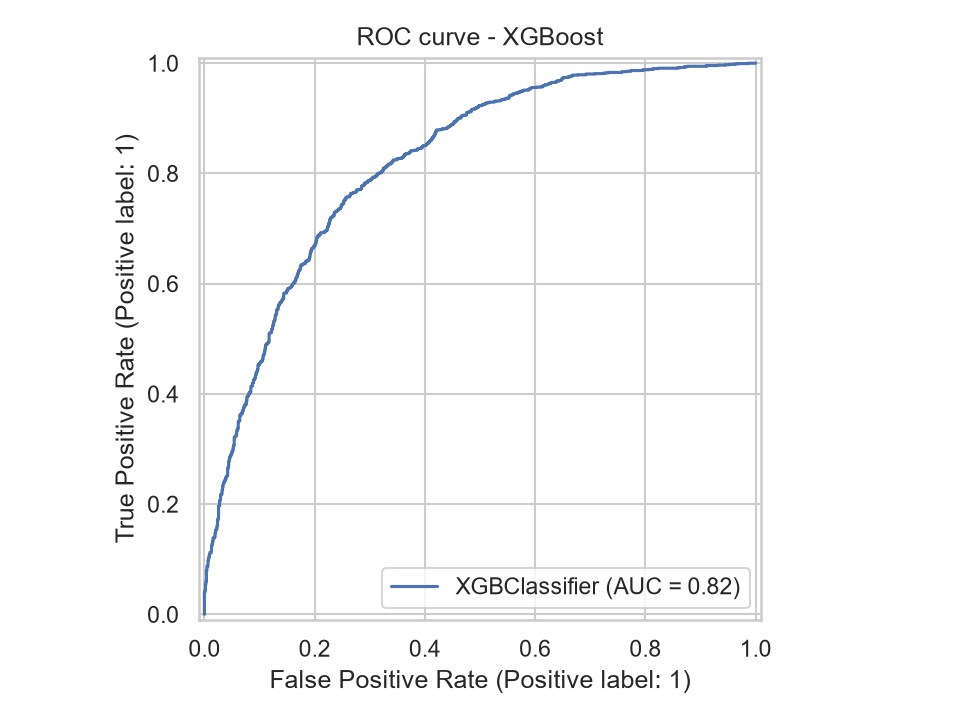
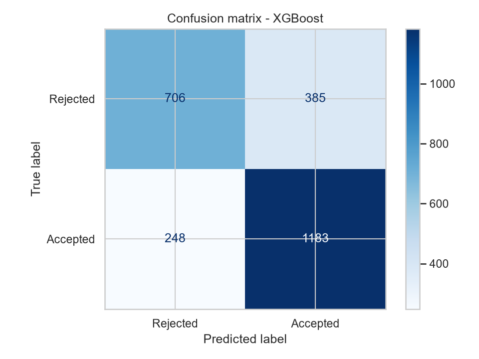
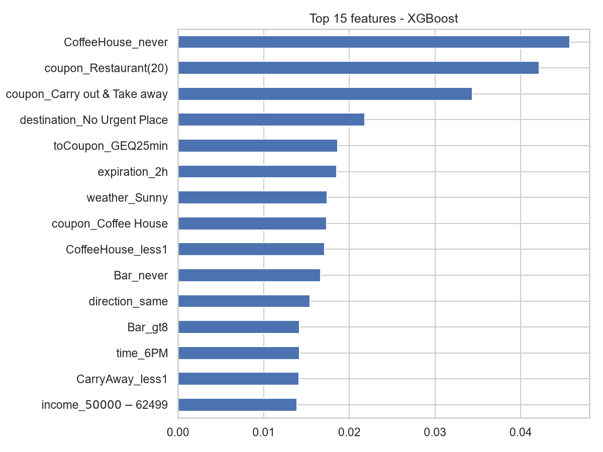
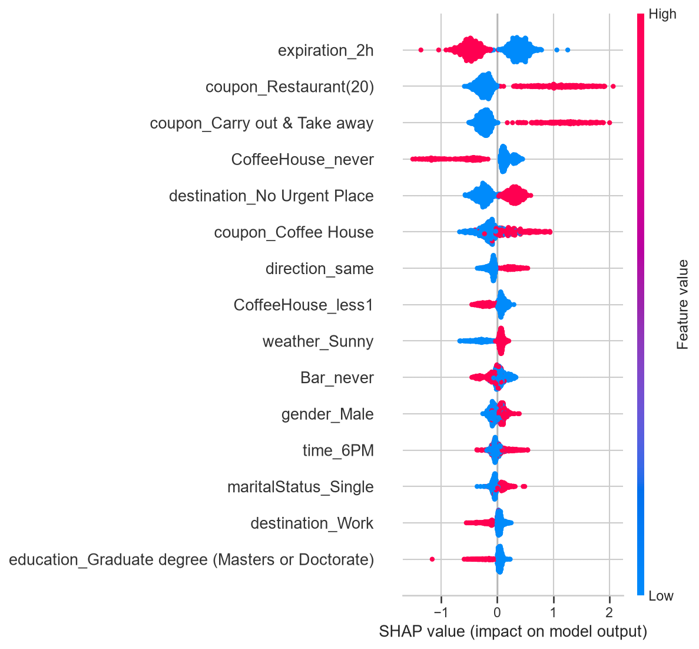
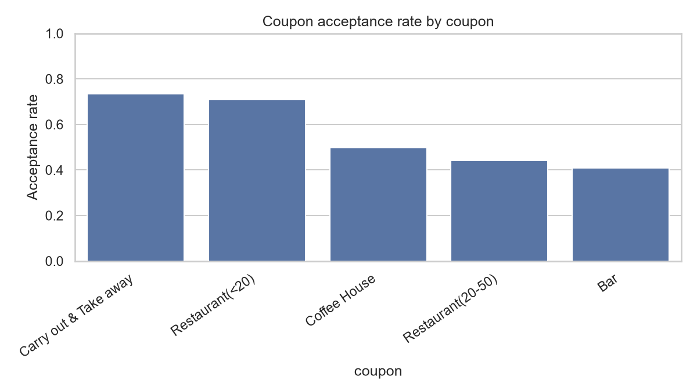
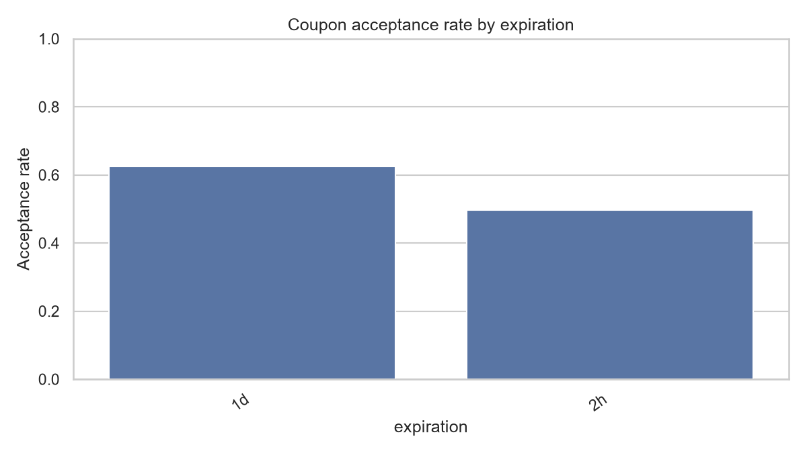

# Coupon Acceptance Prediction

Predicting whether a driver will accept an in-vehicle coupon, using the driving situation, the coupon and the person's profile. The best model, **XGBoost, reaches a ROC-AUC of 0.819**, a 9.6-point improvement over a logistic regression baseline (0.723).

## Business problem

An in-vehicle recommender can show a driver a coupon for a nearby coffee house, bar, take-away or restaurant. Coupons that get rejected waste marketing budget and annoy users. If we can predict **who will accept which coupon, in which situation**, we can send fewer, better-targeted offers.

## Dataset

UCI Machine Learning Repository, *In-Vehicle Coupon Recommendation*: about 12,600 responses from a **survey of hypothetical driving scenarios** collected on Amazon Mechanical Turk. Each row is one person's answer to one scenario.

- **Target:** `Y` (1 = accepted the coupon, 0 = rejected it)
- **Driving situation:** destination, passenger, weather, temperature, time of day, direction and distance to the venue
- **Coupon:** type (coffee house, bar, take-away, restaurant under $20, restaurant $20-50) and expiry (2 hours or 1 day)
- **Person:** age, gender, marital status, children, education, occupation, income
- **Habits:** how often the person normally visits bars, coffee houses, take-away and restaurants

## Approach

1. **Data audit and cleaning:** dropped `car` (almost entirely missing), removed duplicate rows, filled the few missing habit values with the mode, dropped constant columns.
2. **Exploratory analysis:** acceptance rate by coupon, passenger, time, weather, expiry, demographics and past habits, plus coupon-by-context heatmaps.
3. **Modelling:** one-hot encoding, stratified 80/20 split, then Logistic Regression (baseline), Random Forest and XGBoost.
4. **Evaluation:** accuracy, precision, recall, F1 and ROC-AUC on the test set, plus 5-fold cross-validation.
5. **Explainability:** feature importance and SHAP.
6. **Business view:** threshold analysis to choose how many coupons to send.

## Results

| Model | ROC-AUC (test) |
|---|---|
| Logistic Regression (baseline) | 0.723 |
| **XGBoost (best)** | **0.819** |

XGBoost F1 score: **0.789**. The full comparison of all three models is in [`outputs/model_comparison.csv`](outputs/model_comparison.csv).




### How many coupons to send

A higher threshold sends fewer coupons, but a larger share of them is accepted. Sending a coupon to everyone gives about 57% acceptance.

| Threshold | Coupons sent | Precision | Recall | F1 |
|---|---|---|---|---|
| 0.3 | 1,972 | 0.686 | 0.945 | 0.795 |
| 0.4 | 1,759 | 0.722 | 0.887 | 0.796 |
| 0.5 | 1,568 | 0.754 | 0.827 | 0.789 |
| 0.6 | 1,315 | 0.798 | 0.734 | 0.765 |
| 0.7 | 1,011 | 0.837 | 0.591 | 0.693 |
| 0.8 | 674 | 0.864 | 0.407 | 0.553 |

At a threshold of 0.5, targeting with the model lifts acceptance from about 57% to **75.4%**. At 0.7 it reaches **83.7%**, but recall falls to 59.1%.

### Feature importance and SHAP




## Key insights



- **Coupon and timing matter most.** Take-away coupons at 2PM are accepted 86.7% of the time (n = 218) and restaurant (under $20) coupons at 6PM 82.8% (n = 748). Restaurant (under $20) coupons with friends reach 80.1% (n = 826).
- **Some combinations waste coupons.** Bar coupons when travelling with kids are accepted only 21.1% of the time (n = 204), and $20-50 restaurant coupons in snowy weather only 30.5% (n = 177).
- **Past habits predict acceptance for most coupon types.** Coffee house coupons go from 18.9% acceptance for people who never visit coffee houses to 64.7% for those who go 1 to 3 times a month. Bars go from 19.3% to 78.0% (4 to 8 visits a month). Take-away acceptance stays around 74% whatever the habit.
- **Expiry is a controllable lever.** 1-day coupons are accepted 62.4% of the time versus 49.6% for 2-hour coupons, a 12.8-point gap.



## Recommendations

1. Prioritise take-away and low-cost restaurant coupons at mealtime hours.
2. Send coffee house, bar and expensive-restaurant coupons mainly to people who already visit that kind of place at least once a month.
3. Avoid bar coupons for drivers with kids and $20-50 restaurant coupons in snowy weather.
4. Use a 1-day expiry window instead of 2 hours.
5. Rank coupons per driver by predicted probability and set the threshold from the real cost of a coupon and the profit from an accepted one.

## Limitations

- The data is a **survey of hypothetical scenarios**, so stated intent may differ from real behaviour.
- There is no user history over time, no real location and no purchase data.
- Small groups (for example drivers with kids) give less reliable estimates.
- The findings describe associations in survey data, not proven causes.

## Project structure

```
.
├── data/                              # in-vehicle-coupon-recommendation.csv
├── images/                            # charts saved by coupon_project.py
├── outputs/                           # model comparison and threshold tables
├── coupon_acceptance_model.ipynb      # full analysis with commentary
├── coupon_project.py                  # runs the whole pipeline in one command
├── requirements.txt
└── README.md
```

## How to run

```bash
# 1. Create an environment (Python 3.12 recommended)
conda create -n coupon -c conda-forge python=3.12 -y
conda activate coupon

# 2. Install the libraries
pip install -r requirements.txt

# 3a. Run the whole pipeline (saves charts, tables and the model)
python coupon_project.py

# 3b. Or open the notebook
jupyter notebook coupon_acceptance_model.ipynb
```

## Tools

Python, pandas, NumPy, scikit-learn, XGBoost, SHAP, matplotlib, seaborn.

## Data source and citation

Wang, T., Rudin, C., Doshi-Velez, F., Liu, Y., Klampfl, E., and MacNeille, P. (2017). *A Bayesian Framework for Learning Rule Sets for Interpretable Classification.* Journal of Machine Learning Research, 18(70), 1-37. Dataset from the UCI Machine Learning Repository.
